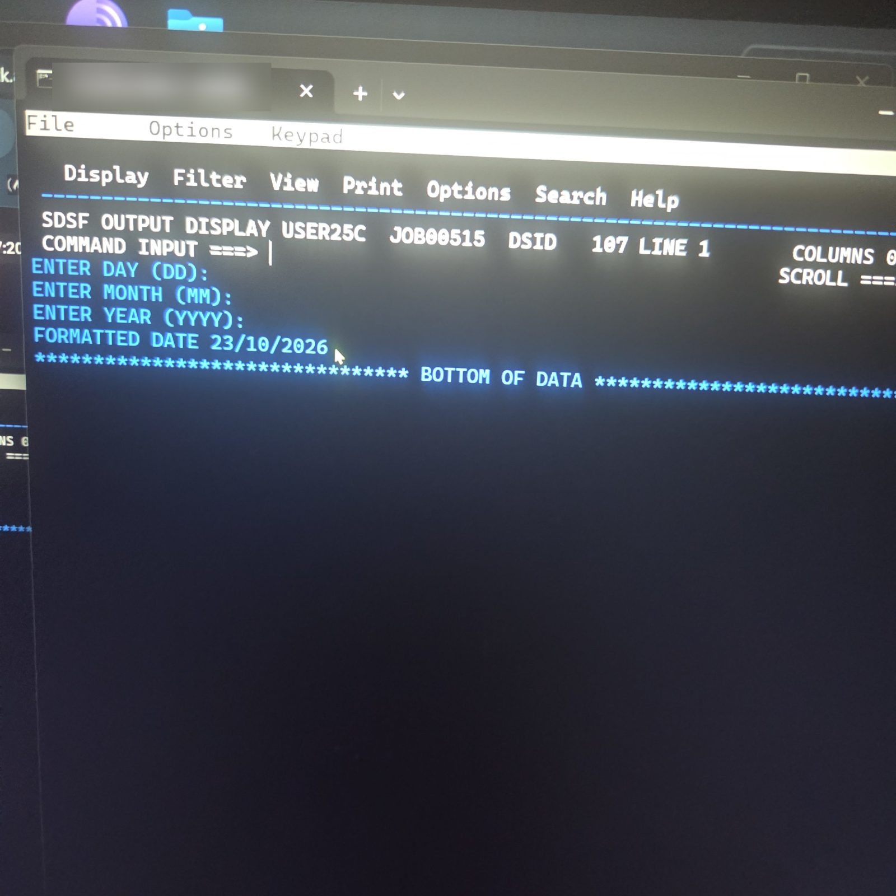
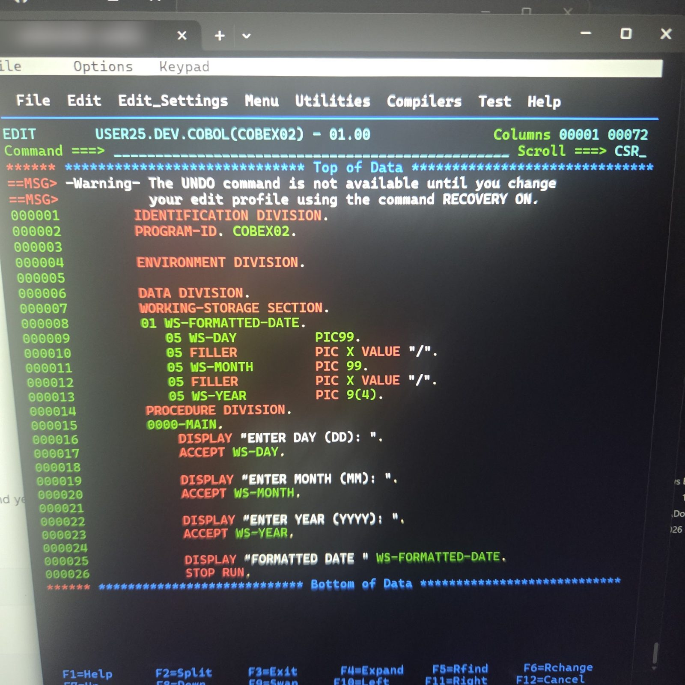
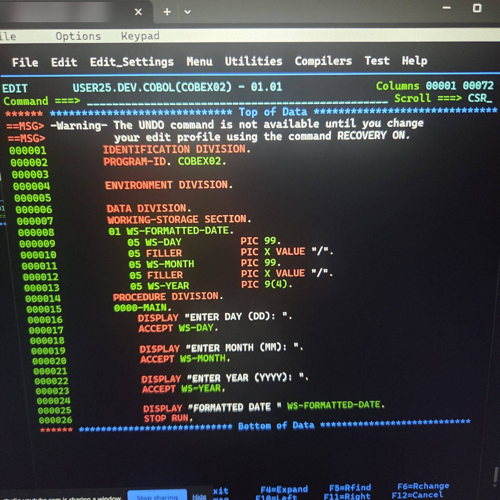
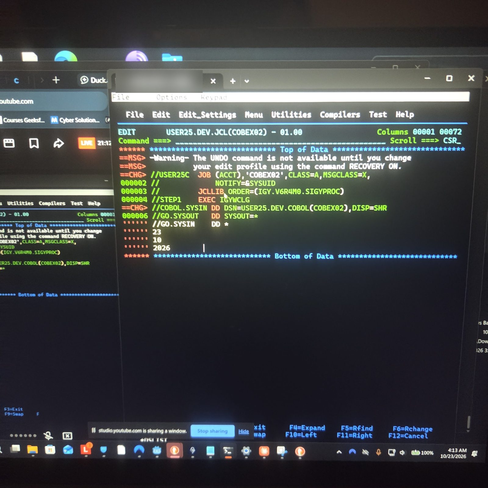
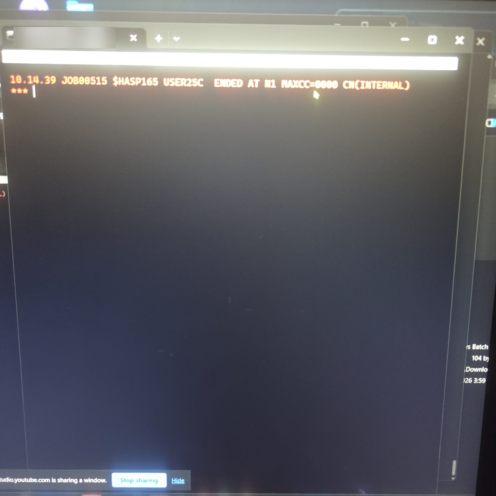
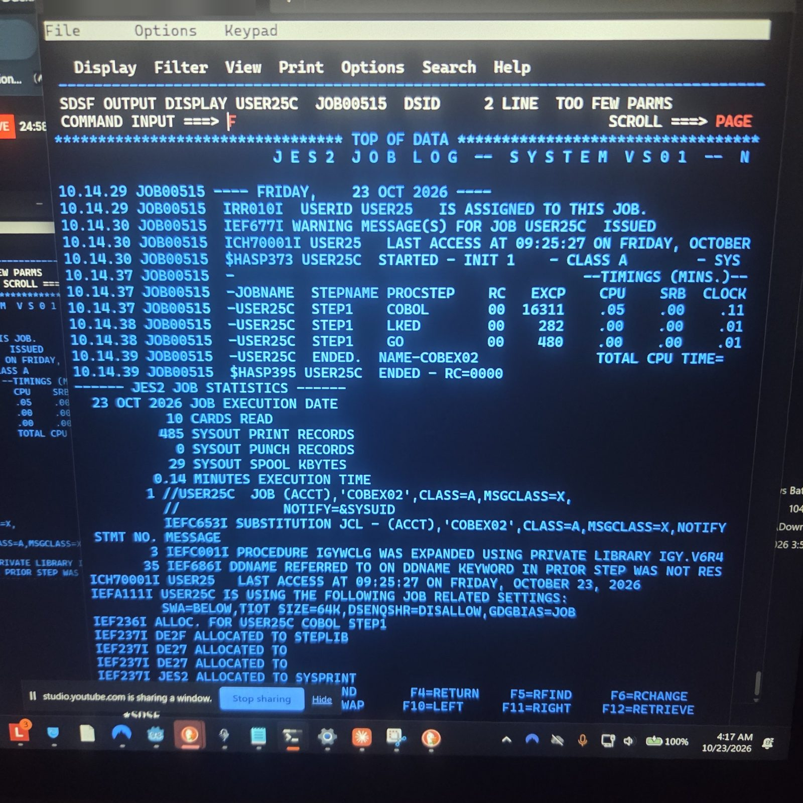

# COBEX02 — Group Variable (Formatted Date)

Exercise from *Module 4 – COBOL Basics, Chapter 1, Lesson 15*, run on IBM z/OS.

**Skills shown:** group items (`01` / `05` levels), `FILLER` with `VALUE`, `ACCEPT` from SYSIN in batch, displaying a whole group in one statement, compile-link-go with `IGYWCLG`.



## The exercise

1. Create a program `COBEX02`.
2. Declare a group variable `WS-FORMATTED-DATE` containing `WS-DAY` (PIC 99), a `"/"` FILLER, `WS-MONTH` (PIC 99), a `"/"` FILLER, and `WS-YEAR` (PIC 9(4)).
3. Fill day, month and year with three `ACCEPT` statements.
4. Display `WS-FORMATTED-DATE` in a single instruction.

## Files

| File | Mainframe dataset | Purpose |
|---|---|---|
| [`cobol/COBEX02.cbl`](cobol/COBEX02.cbl) | `USER25.DEV.COBOL(COBEX02)` | COBOL source |
| [`jcl/COBEX02.jcl`](jcl/COBEX02.jcl) | `USER25.DEV.JCL(COBEX02)` | Compile, link and run in one job, with input on `GO.SYSIN` |

## How the group variable works

The group is one 10-byte field made of five pieces laid end to end:

```
WS-FORMATTED-DATE (10 bytes)
┌────────┬───┬──────────┬───┬──────────────┐
│ WS-DAY │ / │ WS-MONTH │ / │   WS-YEAR    │
│   23   │   │    10    │   │     2026     │
└────────┴───┴──────────┴───┴──────────────┘
  2 bytes  1     2 bytes  1      4 bytes
```

The `FILLER` slashes already hold `"/"` from their `VALUE` clause. The `ACCEPT`s fill only the three named fields, so one `DISPLAY WS-FORMATTED-DATE` prints the finished date.

## The JCL

`IGYWCLG` is IBM's **C**ompile, **L**ink, **G**o procedure, so one job does everything. In batch, `ACCEPT` reads from `SYSIN` of the step that runs the program, which is the `GO` step:

```jcl
//GO.SYSIN    DD *
23
10
2026
/*
```

Each `ACCEPT` reads one line, in order. The values must start in **column 1**: `ACCEPT WS-DAY` takes the first 2 characters of the line, so an indented `23` would read as spaces.

## Result

Job `USER25C` ended with `MAXCC=0000`. All three steps (`COBOL`, `LKED`, `GO`) returned RC 00.

SYSOUT of step `GO`:

```
ENTER DAY (DD):
ENTER MONTH (MM):
ENTER YEAR (YYYY):
FORMATTED DATE 23/10/2026
```

The prompts print with no answers next to them because nobody types in batch. The input comes from `GO.SYSIN`.

## Screenshots

| | |
|---|---|
| **First draft:** `PIC99.` on line 9 is missing a space | **Fixed:** `PIC 99.`, version 01.01 |
|  |  |
| **JCL:** input values in column 1 under `//GO.SYSIN` | **Job ended:** `MAXCC=0000` |
|  |  |
| **Job log:** `COBOL`, `LKED` and `GO` all RC 00 | **Output:** `FORMATTED DATE 23/10/2026` |
|  |  |

*Host address blurred in all screenshots.*

## Troubleshooting log

| Symptom | Cause | Fix |
|---|---|---|
| `PIC99.` would not compile | No space between `PIC` and the picture | `PIC 99.` |
| Input values indented under `//GO.SYSIN` | Down arrow keeps the cursor's column in ISPF | Move each value to column 1 with Delete |
| `TOO FEW PARMS` in SDSF | `F` typed with no search text | `F 'FORMATTED DATE'` |

## Steps on the mainframe

1. Edit `USER25.DEV.COBOL(COBEX02)`, then `SAVE`.
2. In `USER25.DEV.JCL`, create the job with `S COBEX02`, then `COPY COBEX01` and `C COBEX01 COBEX02 ALL`.
3. Insert the `GO.SYSIN` lines with `I4`, then `SAVE` and `SUB`.
4. Check output in SDSF: `=SD`, `ST`, `S` next to the job, then `F 'FORMATTED DATE'`.
