# COBEX03 — Arithmetic (ADD, SUBTRACT, MULTIPLY, DIVIDE, COMPUTE)

Run on IBM z/OS with IBM Enterprise COBOL 6.4.

**Skills shown:** the five arithmetic verbs with `GIVING`, `ROUNDED`, `ON SIZE ERROR`, and **numeric-edited pictures** (`Z`, `.`, `-`) so results print in a readable form. Compiled with a separate compile job (`COBCOMP`) and run from the load library.

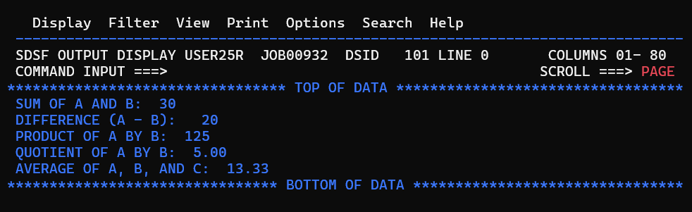

## The exercise

1. Declare three numbers `A`, `B` and `C` (`PIC 99`).
2. Put the sum of A and B in `WS-ADD`.
3. Put the difference (A − B) in `WS-SUB`.
4. Put the product of A and B in `WS-MUL`.
5. Put the quotient of A by B in `WS-DIV`.
6. Put the average of A, B and C in `WS-MOY`.
7. Display each result with an explanatory `DISPLAY`.

## Workflow

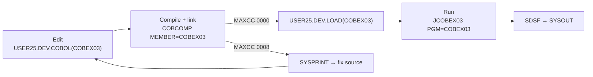

## Files

| File | Mainframe dataset | Purpose |
|---|---|---|
| [`cobol/COBEX03.cbl`](cobol/COBEX03.cbl) | `USER25.DEV.COBOL(COBEX03)` | COBOL source |
| [`jcl/JCOBEX03.jcl`](jcl/JCOBEX03.jcl) | `USER25.DEV.JCL(JCOBEX03)` | Runs the compiled program |

The compile job is the same `COBCOMP` used in [COBEX06](../cobex06/jcl/COBCOMP.jcl), with `MEMBER=COBEX03`.

## Choosing the pictures

The result fields are **numeric-edited**: a `GIVING` or `COMPUTE` target can be an edited field, so the result lands directly in a printable format with no extra variables.

| Field | Worst case (A, B ≤ 99) | PIC | Why |
|---|---|---|---|
| `WS-ADD` | 198 | `ZZ9` | 3 digits, leading zeros blanked |
| `WS-SUB` | −99 | `-ZZ9` | `-` prints the sign when negative |
| `WS-MUL` | 9801 | `ZZZ9` | 4 digits |
| `WS-DIV` | 99.00, or fractions like 3.75 | `Z9.99` | `.` prints the decimal point |
| `WS-MOY` | 99.00 | `ZZ9.99` | Average needs decimals |

`Z` = blank instead of a leading zero · `.` = printed decimal point · `-` = sign · `V` = **implied** decimal point (stored, never printed).

## Result

`A = 25`, `B = 5`, `C = 10`. Compile `MAXCC=0000`, run `MAXCC=0000` (job `JOB00932`). SYSOUT:

```
SUM OF A AND B:  30
DIFFERENCE (A - B):   20
PRODUCT OF A BY B:  125
QUOTIENT OF A BY B:  5.00
AVERAGE OF A, B, AND C:  13.33
```

## Troubleshooting log

| Symptom | Cause | Fix |
|---|---|---|
| `IGYDS1082-E A period was required. A period was assumed before "01".` → `MAXCC=0008` | A leftover field definition with no period on the line before an `01` | Deleted the unused line |
| Periods right after the names (`01 WS-ADD.   PIC S999.`) | The first period ends the entry, leaving `PIC` orphaned | One period, at the end of the line |
| Leftover lines containing only `//` and `Block command incomplete` | A repeat/block line command was only half typed | `RESET`, `CAN`, and start the member again with `I7` |
| `JCL ERROR`, JESJCL shows only the job card | `MGSLEVEL` typed instead of `MSGLEVEL` | `MSGLEVEL=(1,1)` |
| SUM printed as `03{` | `WS-ADD PIC S999`: a signed DISPLAY field stores its sign in the last digit (+0 shows as `{`) | Edited PIC `ZZ9` |
| AVERAGE printed as `01333`, QUOTIENT as `0500` | `V` is an implied decimal point and never prints | Edited PICs with `.`: `ZZ9.99`, `Z9.99` |
| QUOTIENT printed as `500` | `V` used inside an edited PIC instead of `.` | `Z9.99` |
| Source fixed but the output didn't change | The run job executes the copy in the load library | Recompile with `COBCOMP` before every rerun |

## Lessons learned

- Always use **`GIVING`**: `ADD A TO B` without it overwrites `B`.
- **Numeric PICs** (`9`, `S`, `V`) are for storing and calculating; **edited PICs** (`Z`, `.`, `-`) are for display. An edited field can't be used in further math.
- Protect `DIVIDE` with `ON SIZE ERROR` so a zero divisor doesn't abend the program.
- A line holding only `//` in JCL is the null statement, which means end of job.

## Screenshots

| | |
|---|---|
| 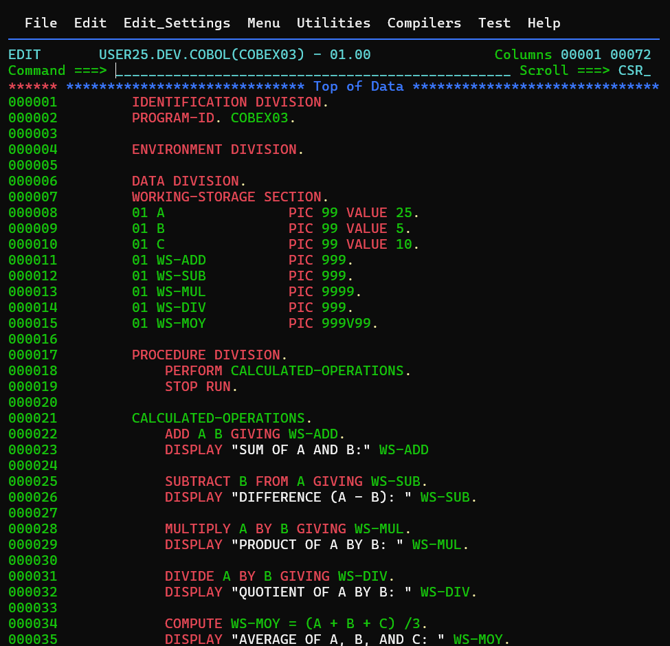 | 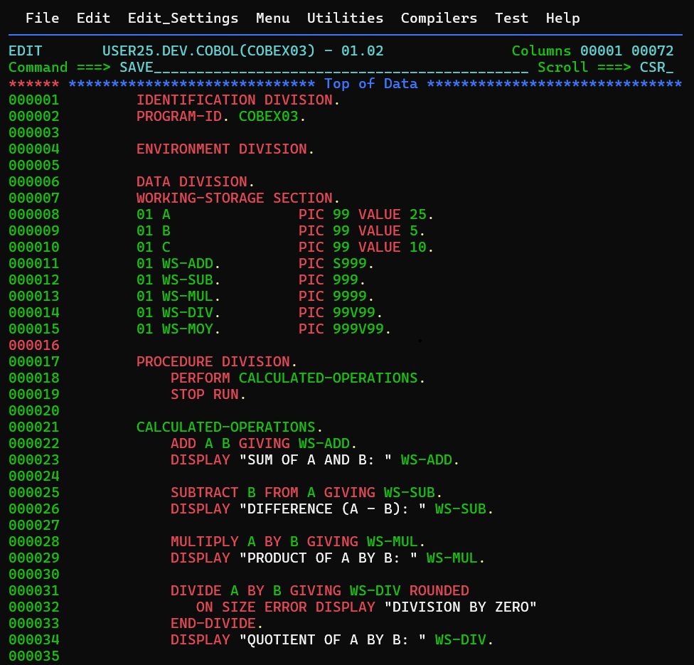 |
| 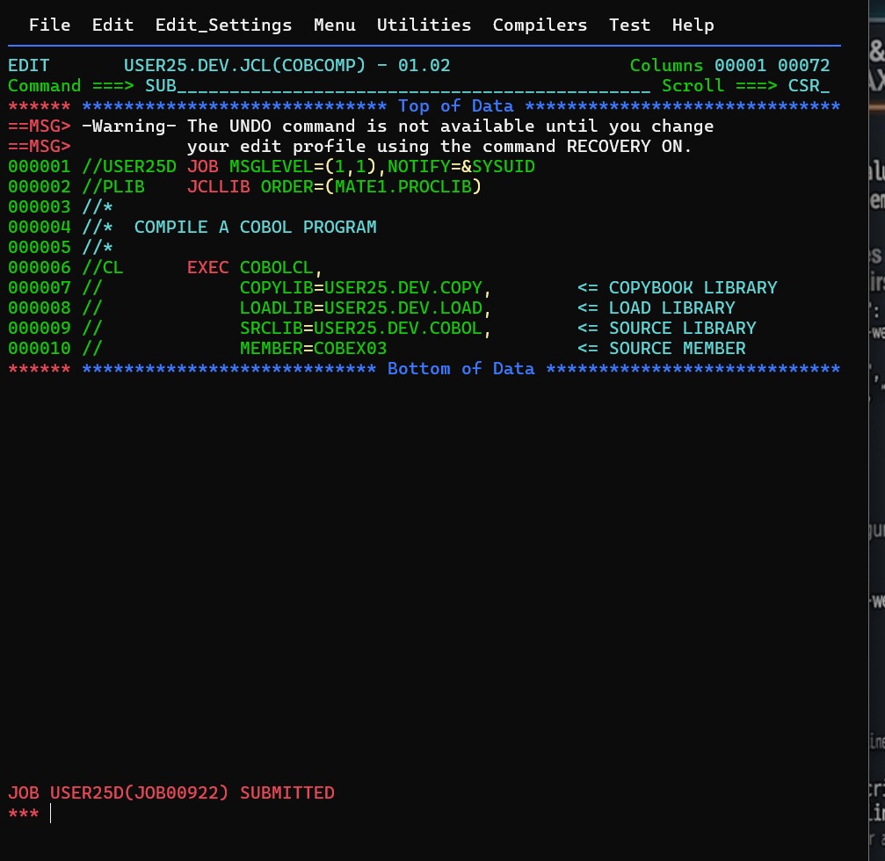 | 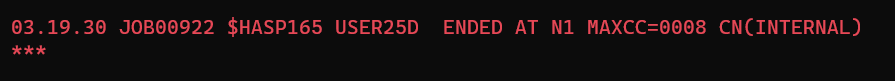 |
| 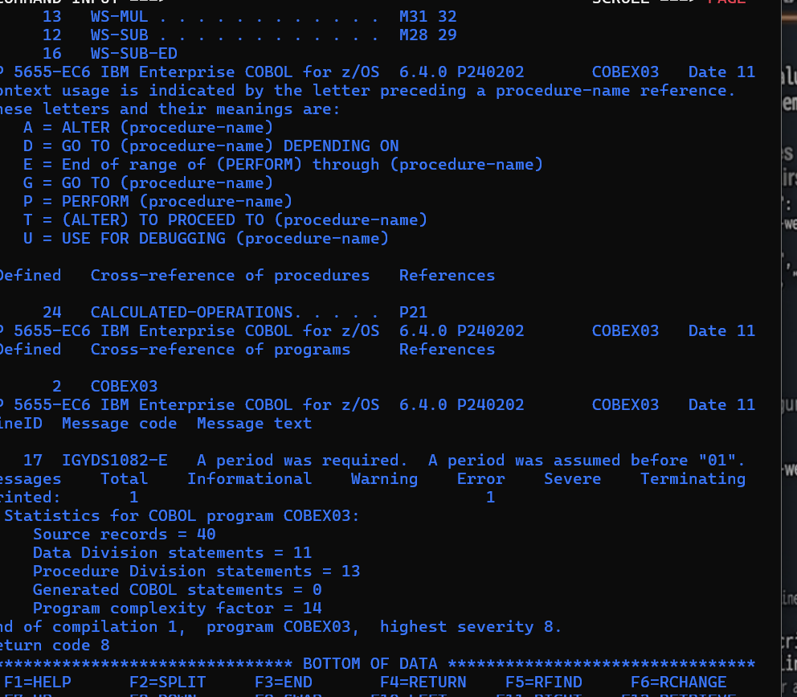 | 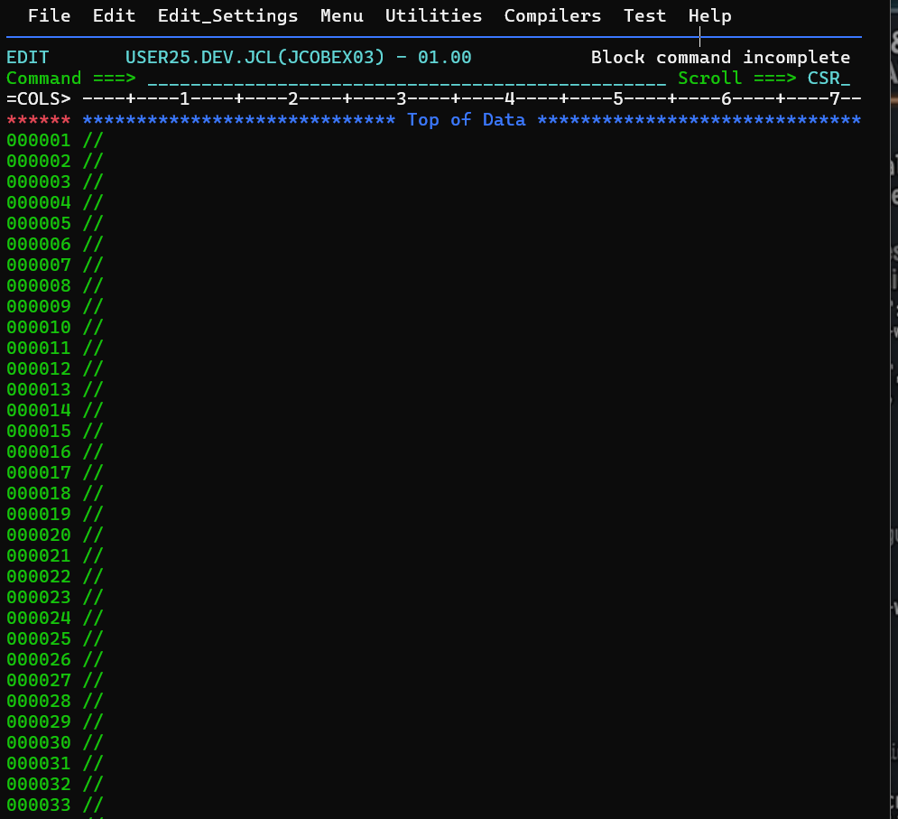 |
| 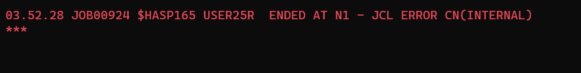 | 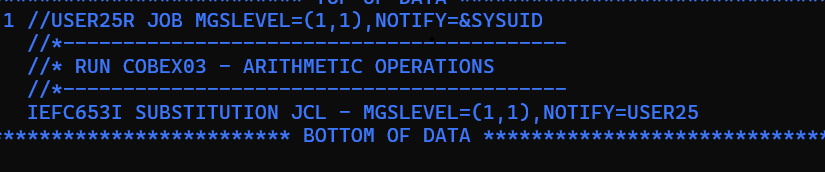 |
| 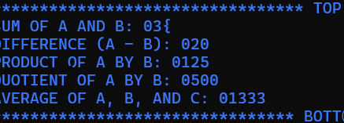 | 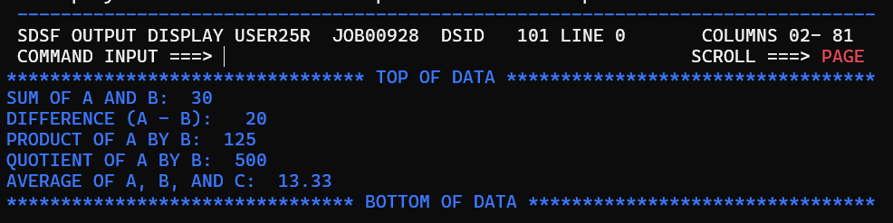 |
|  | 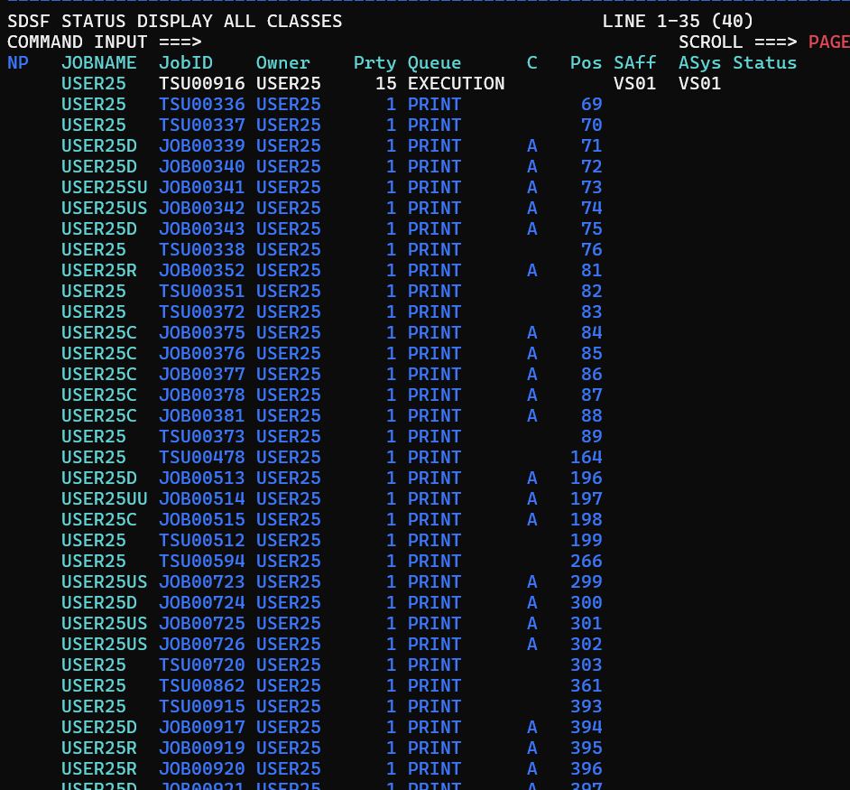 |
