# COBEX04 — Access Control (IF, EVALUATE, level 88)

Run on IBM z/OS with IBM Enterprise COBOL 6.4.

**Skills shown:** a level-88 condition name over a value range, `IF` with a condition name, `EVALUATE` with `THRU` ranges and `WHEN OTHER`, and the compile-then-run cycle (including what an S806 abend means).

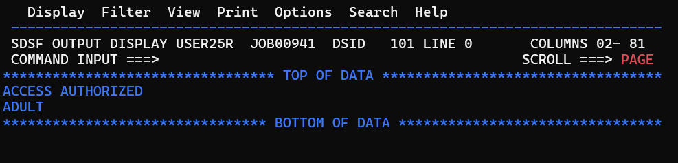

## The exercise

1. Create a program `COBEX04`.
2. Declare `WS-AGE` (`PIC 999`).
3. Add a level-88 condition name `IS-ADULT` for the values 18 to 999.
4. Populate `WS-AGE`.
5. Use an `IF` with the condition name to display "ACCESS AUTHORIZED" for an adult.
6. Use an `EVALUATE` on the same variable to display "CHILD" (0–12), "TEEN" (13–17) or "ADULT" (the rest).

## Workflow

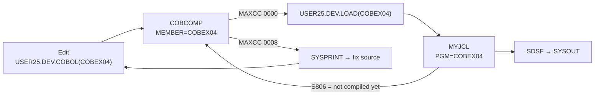

## Files

| File | Mainframe dataset | Purpose |
|---|---|---|
| [`cobol/COBEX04.cbl`](cobol/COBEX04.cbl) | `USER25.DEV.COBOL(COBEX04)` | COBOL source |
| [`jcl/MYJCL.jcl`](jcl/MYJCL.jcl) | `USER25.DEV.JCL(MYJCL)` | Runs the compiled program |

Compiled with the same `COBCOMP` job as [COBEX06](../cobex06/jcl/COBCOMP.jcl), with `MEMBER=COBEX04`.

## How it works

| Code | Meaning |
|---|---|
| `88 IS-ADULT VALUE 18 THRU 999.` | A condition name on `WS-AGE`, with no PIC of its own. It's true whenever `WS-AGE` is between 18 and 999 |
| `IF IS-ADULT` | Reads like English. It's the same test as `IF WS-AGE >= 18`, but the rule lives in one place |
| `EVALUATE WS-AGE … WHEN 0 THRU 12 …` | COBOL's switch/case. The first matching `WHEN` runs; `WHEN OTHER` catches everything else |

No periods inside `IF` / `EVALUATE`; only after `END-IF.` and `END-EVALUATE.`

## Result

`WS-AGE = 25` → compile `MAXCC=0000`, run `MAXCC=0000` (job `JOB00941`). SYSOUT:

```
ACCESS AUTHORIZED
ADULT
```

Other test values: 8 → `CHILD` · 15 → `TEEN` · 18 → `ACCESS AUTHORIZED` + `ADULT` (boundary).

## Troubleshooting log

| Symptom | Cause | Fix |
|---|---|---|
| `EXEC PG=COBEX04` | Typo | `PGM=COBEX04` |
| `ABENDED S806` | Program not found in the load library: the run job was submitted before a successful compile | Compile with `COBCOMP` (`MEMBER=COBEX04`) first |
| `Invalid DSN - syntax` | Extra period: `'USER25.DEV.JCL.(COBCOMP)'` | `'USER25.DEV.JCL(COBCOMP)'` |
| `IGYDS1005-E The "DATA DIVISION" header was not found` → `MAXCC=0008` | The `DATA DIVISION` header line wasn't recognized (a header must start in Area A, column 8; a `D` in column 7 marks a debugging line) | Fixed line 5 so the header starts in column 8 |

## Screenshots

| | |
|---|---|
| 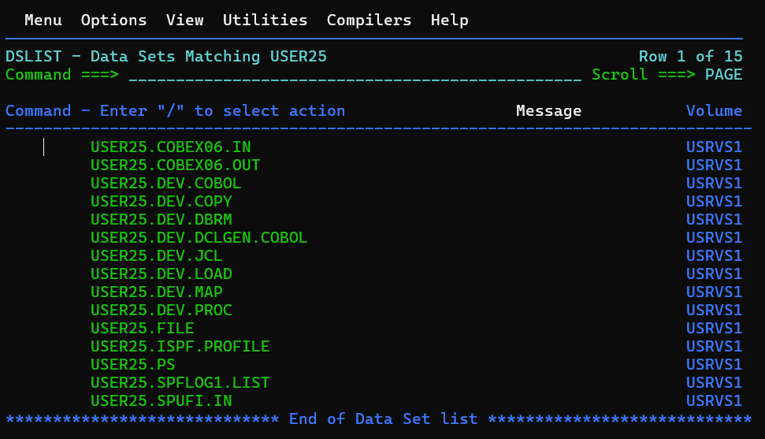 | 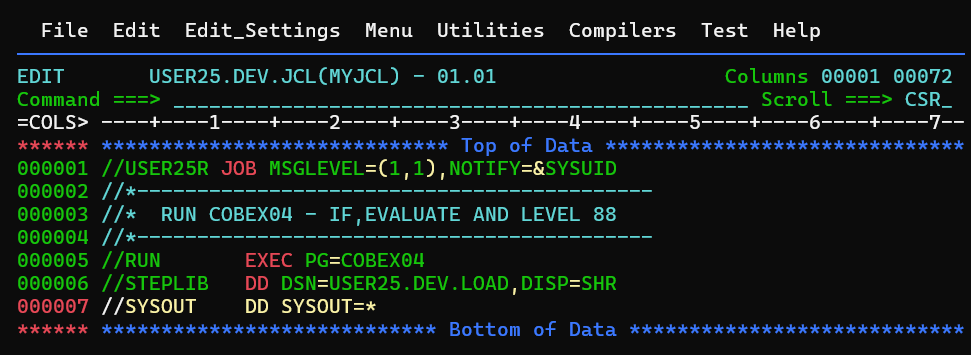 |
| 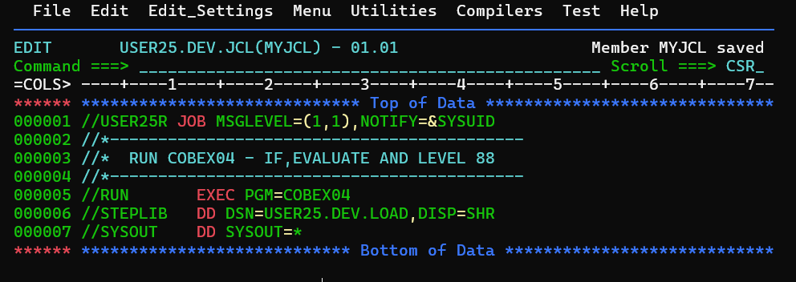 | 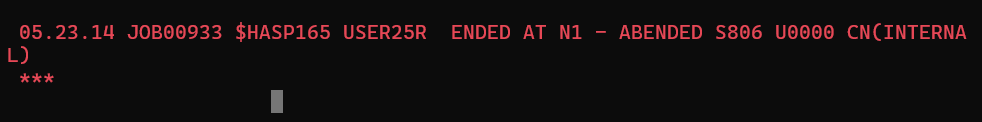 |
| 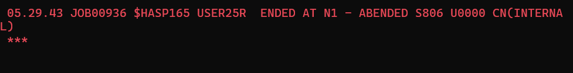 | 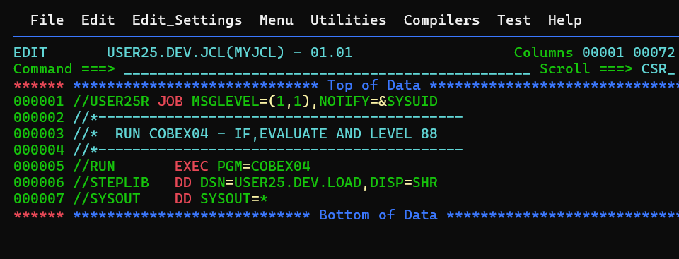 |
| 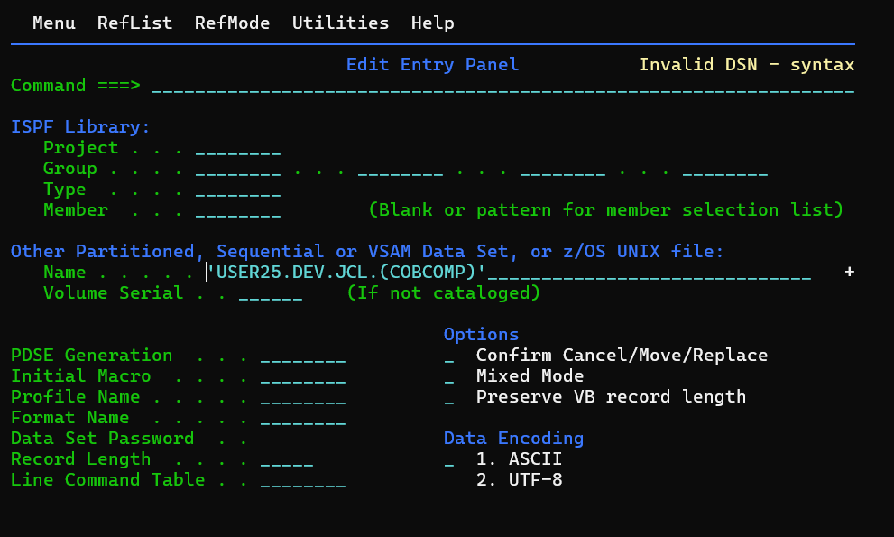 | 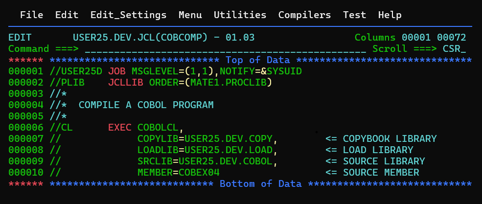 |
| 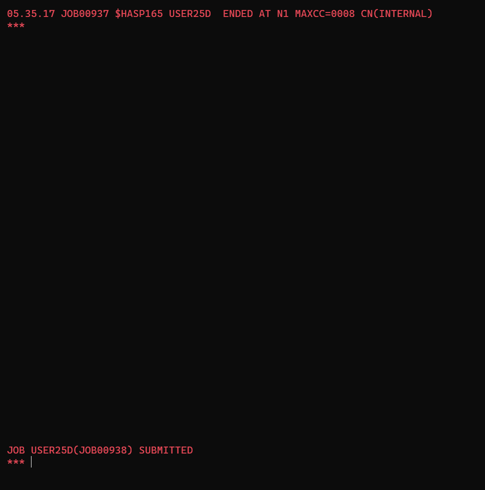 | 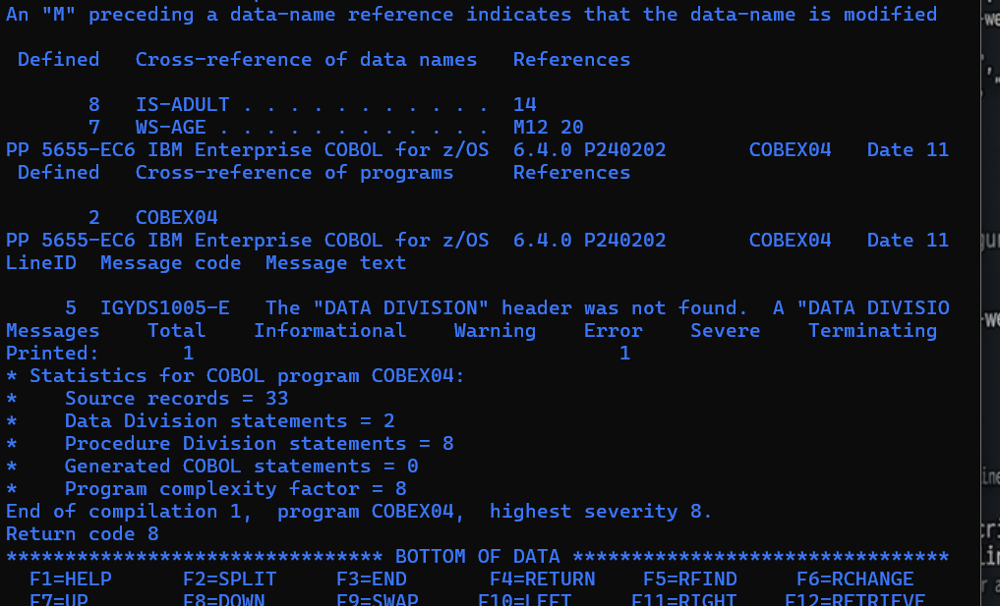 |
|  | |
