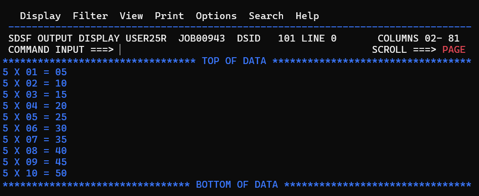
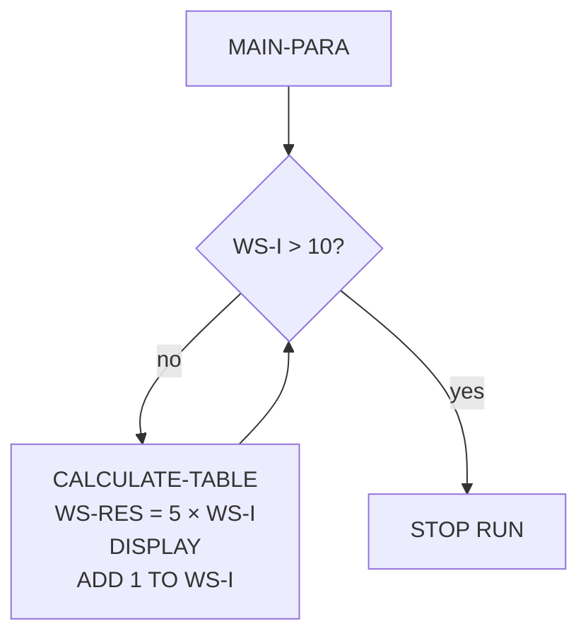
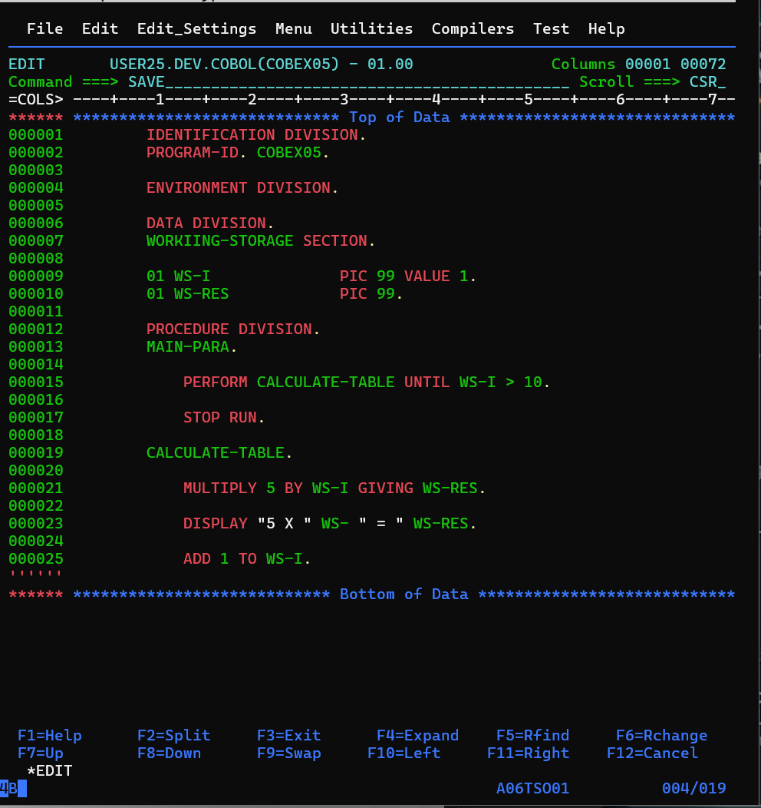
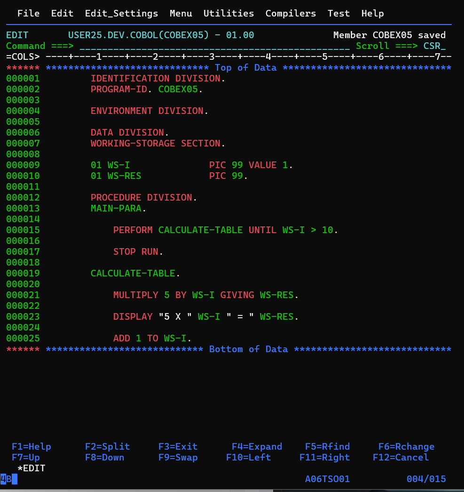
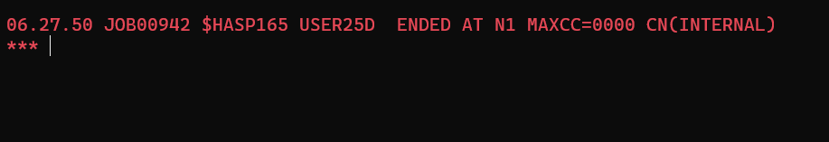
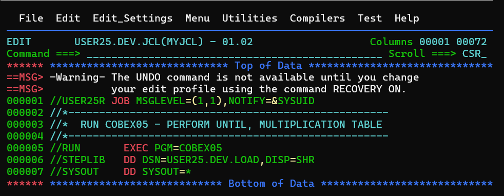
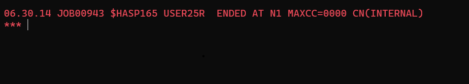

# COBEX05 — PERFORM UNTIL: Multiplication Table for 5

Run on IBM z/OS with IBM Enterprise COBOL 6.4.

**Skills shown:** `PERFORM … UNTIL` loops, paragraph organization (a main paragraph plus a worker paragraph), counters with `VALUE`, and `MULTIPLY … GIVING`.



## The exercise

1. Create a program `COBEX05`.
2. Declare a counter `WS-I` (`PIC 99`) initialized to 1, and `WS-RES` (`PIC 99`).
3. Use `PERFORM … UNTIL` to call the paragraph `CALCULATE-TABLE` until the counter exceeds 10.
4. In that paragraph, multiply 5 by `WS-I` into `WS-RES`, display the calculation (e.g. `5 X 01 = 05`), and increment `WS-I`.

## Workflow



Build cycle: edit `USER25.DEV.COBOL(COBEX05)` → `COBCOMP` with `MEMBER=COBEX05` (MAXCC 0000) → `MYJCL` with `PGM=COBEX05` (MAXCC 0000) → SDSF SYSOUT.

## Files

| File | Mainframe dataset | Purpose |
|---|---|---|
| [`cobol/COBEX05.cbl`](cobol/COBEX05.cbl) | `USER25.DEV.COBOL(COBEX05)` | COBOL source |
| [`jcl/MYJCL.jcl`](jcl/MYJCL.jcl) | `USER25.DEV.JCL(MYJCL)` | Runs the compiled program |

Compiled with the same `COBCOMP` job as [COBEX06](../cobex06/jcl/COBCOMP.jcl), with `MEMBER=COBEX05`.

## How it works

- `PERFORM CALCULATE-TABLE UNTIL WS-I > 10` checks the condition **before** each call, so the paragraph runs for `WS-I` = 1 to 10.
- `PIC 99` prints leading zeros, which gives exactly the `5 X 01 = 05` format. The largest result, 5 × 10 = 50, fits in two digits.
- `ADD 1 TO WS-I` is what ends the loop. Without it, the counter stays at 1 and the loop never stops.
- `STOP RUN` sits before `CALCULATE-TABLE`. COBOL runs paragraphs top to bottom, so without it the program would fall into the paragraph one more time and print `5 X 11 = 55`.

## Result

Compile `JOB00942` MAXCC=0000 · run `JOB00943` MAXCC=0000. SYSOUT:

```
5 X 01 = 05
5 X 02 = 10
5 X 03 = 15
5 X 04 = 20
5 X 05 = 25
5 X 06 = 30
5 X 07 = 35
5 X 08 = 40
5 X 09 = 45
5 X 10 = 50
```

## Troubleshooting log

| Symptom | Cause | Fix |
|---|---|---|
| `WORKIING-STORAGE SECTION.` | Typo; it would leave both variables undefined | `WORKING-STORAGE` |
| `DISPLAY "5 X " WS- " = " WS-RES.` | Variable name cut off | `WS-I` |

Both were caught by reviewing the screen before compiling, so the first compile was clean.

## Screenshots

| | |
|---|---|
|  |  |
|  |  |
|  |  |
